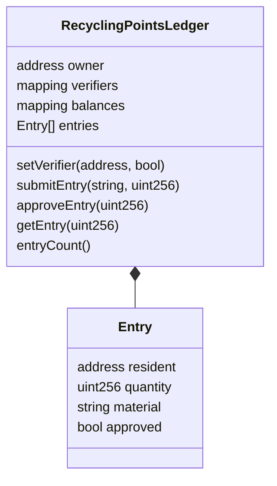

# Recycling Points Ledger — Implementation Report

Student: Nguyễn Bá Thiện — ID 29211164940

Course: DS 441 A — Blockchain: Theory & Practices

## 1. Scope

The individual assignment requires residents to submit a material and quantity, verifiers to approve each entry once, and balances to reflect the quantity awarded as non-transferable points. Deliverables include Solidity and interface source, deployment/test scripts, a README, and screenshots or a recording.

The individual PDF does not require a 4–6-page report or mandate MetaMask specifically. This report supplements the required explanation with design, security, and gas analysis.

## 2. Contract design

| Component | Purpose |
|---|---|
| owner | Immutable deployer; grants and revokes verifier permission |
| verifiers[address] | Indicates permission to approve |
| balances[address] | Accumulated resident points |
| entries | Entries with resident, quantity, material, and approved status |

submitEntry derives the resident from msg.sender. Quantity must be a positive integer and material length must be 1–64 bytes. New entries do not award points until approved. IDs start at 0.

approveEntry requires an authorized verifier, an existing entry, and an unset approval flag. It sets the flag and adds quantity to the resident's balance. An overflow reverts the entire transaction, including the flag update.

Only the owner can call setVerifier. The owner is initially a verifier but may revoke that permission and restore it through the retained owner role. No transfer, spending, or withdrawal functions exist. Business functions do not receive or transfer Ether.

EntrySubmitted, EntryApproved, and VerifierUpdated record important changes. The interface displays the connected account, role, balance, latest 100 entries, and the latest submitted transaction's hash, block, gas, and events.

## 3. Testing and evidence

npm test deploys a fresh contract on in-process Ganache with separate owner, resident, and verifier accounts. Full results are in [test-results.json](../evidence/test-results.json).

The 16 checks cover initial state, submission/events, authorization, role grants/revocations, exact awards, duplicate approval, a mined unauthorized transaction, zero quantities, empty/oversized materials, missing IDs, non-owner administration, zero addresses, balance accumulation/isolation, and the absence of transfer methods. One unauthorized transaction has receipt status 0; other rejection checks use eth_call.

| Screenshot | Evidence |
|---|---|
| [01-resident-submitted.png](../evidence/screenshots/01-resident-submitted.png) | Paper 12 submitted; pending balance remains 0 |
| [02-unauthorized-rejected.png](../evidence/screenshots/02-unauthorized-rejected.png) | Resident approval rejected with Only verifier |
| [02-verifier-approved.png](../evidence/screenshots/02-verifier-approved.png) | Owner approval; resident balance becomes 12 |
| [04-duplicate-rejected.png](../evidence/screenshots/04-duplicate-rejected.png) | Repeat approval rejected with Already approved |
| [03-mobile.png](../evidence/screenshots/03-mobile.png) | Interface at a mobile viewport size |

Screenshots use real in-process Ganache through an EIP-1193 test-wallet bridge, not MetaMask. Invalid approval calls exercise the interface's transaction handler despite hidden buttons, demonstrating contract enforcement.

## 4. Gas and optimization

Measured receipts in evidence/test-results.json use solc 0.8.24, optimizer 200 runs, and EVM Shanghai. Costs apply to these specific transactions.

| Transaction | Gas used |
|---|---:|
| Submit Paper 12, first entry | 116697 |
| Grant verifier permission | 45718 |
| First approval, award 12 points | 77170 |
| Unauthorized approval, reverted | 23729 |
| Submit Plastic 3, second entry | 99621 |
| Revoke verifier permission | 23806 |
| Approve second entry | 60082 |

Gas varies with storage state and inputs. The second submission also uses another material string, so its difference does not measure optimizer savings. Transaction fee equals gas used multiplied by gas price. Reverted transactions consume gas; ordinary eth_call reads do not create fee-paying transactions.

Optimizations include immutable owner, avoiding a storage read for owner checks; string calldata, avoiding an unnecessary input copy solely for validation; and compiler optimization at 200 runs. No percentage saving is claimed without an unoptimized baseline. A simple ledger avoids unnecessary ERC-20 behavior for non-transferable points.

## 5. Security and limitations

- Solidity enforces permissions; hidden controls are not a security boundary.
- The approval flag prevents duplicate awards for one ID. No external business-function calls or callback paths exist.
- Entries belong to msg.sender; residents cannot nominate another sender. Solidity 0.8 checks overflow.
- The interface uses textContent. All on-chain descriptions and addresses are public.
- Physical verification occurs off chain. Repeated descriptions are possible; only repeat approval of the same ID is prevented.
- Verifiers can approve their own entries because the assignment does not prohibit it. The owner is a central trust point; ownership cannot be transferred.
- The interface loads the latest 100 entries; all entries remain on chain. Quantities use standardized integer units.
- Localhost RPC deployment and actual MetaMask signing remain unverified in this environment. Setup and manual demonstration steps appear in the README and [DEMO.md](DEMO.md).

## 6. Sources and assistance

The instructor's individual PDF defines the requirements. The Web3.py example illustrates RPC, ABI, and address connections; this implementation uses ethers.js as permitted. OpenAI Codex assisted with code, scripts, and documentation. Dependencies include solc 0.8.24, ethers 6.13.4, Ganache 7.9.2, and Playwright 1.51.1 for screenshots.
